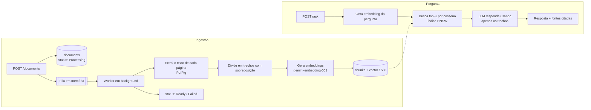

# AskMyDocs

Faça perguntas sobre seus PDFs e receba respostas baseadas no conteúdo deles, com citação do arquivo e da página exatos.

O AskMyDocs é uma API de **RAG (Retrieval-Augmented Generation)** construída com **.NET 10**, **PostgreSQL + pgvector** e **Google Gemini** (plano gratuito). Funciona com qualquer API compatível com a da OpenAI, então dá para trocar de provedor só pela configuração. Você envia um PDF; ele é dividido em trechos, convertido em embeddings e indexado. Quando você faz uma pergunta, os trechos mais relevantes são recuperados por similaridade vetorial e o modelo responde **usando apenas esses trechos**.

## Funcionalidades

- 📄 Upload de PDF com processamento em background (a requisição retorna na hora com `202 Accepted`)
- ✂️ Divisão em trechos por página, com sobreposição, para não perder contexto nas bordas
- 🔎 Busca semântica com pgvector (índice HNSW, distância de cosseno)
- 💬 Respostas fundamentadas com citações `[n]`, nome do arquivo e número da página de cada fonte
- 🎯 Filtro opcional para perguntar apenas sobre documentos específicos
- 🌎 Responde no mesmo idioma da pergunta
- 🛡️ Ingestão resiliente: falhas ficam registradas no documento (`Failed` + motivo) em vez de derrubar a API

## Como funciona



## Tecnologias

| Área | Tecnologia |
| --- | --- |
| API | ASP.NET Core 10 Minimal APIs, OpenAPI, Scalar |
| Banco de dados | PostgreSQL 17 + [pgvector](https://github.com/pgvector/pgvector), EF Core 10, Npgsql |
| IA | [Google Gemini](https://aistudio.google.com) pela API compatível com a OpenAI, usando o [OpenAI .NET SDK](https://github.com/openai/openai-dotnet): `gemini-embedding-001` (embeddings), `gemini-3.5-flash-lite` (respostas) |
| PDF | [PdfPig](https://github.com/UglyToad/PdfPig) |
| Processamento em background | `System.Threading.Channels` + `BackgroundService` |
| Testes | xUnit |

## Como rodar

### Pré-requisitos

- [.NET 10 SDK](https://dotnet.microsoft.com/download)
- [Docker](https://www.docker.com/) (para o PostgreSQL com pgvector)
- Uma [chave de API do Gemini](https://aistudio.google.com/apikey) (gratuita, basta uma conta Google)

### 1. Suba o banco de dados

```bash
docker compose up -d
```

Isso sobe o `pgvector/pgvector:pg17` na **porta 5433 do host** (para não conflitar com um PostgreSQL instalado localmente na 5432). A connection string de desenvolvimento em `appsettings.Development.json` já aponta para ele.

### 2. Configure sua chave do Gemini

Crie uma chave gratuita em [Google AI Studio](https://aistudio.google.com/apikey) e salve nos user secrets:

```bash
dotnet user-secrets set "AI:ApiKey" "SUA-CHAVE" --project src/AskMyDocs.Api
```

Outra opção é definir a variável de ambiente `AI__ApiKey`.

> **Plano gratuito do Gemini:** tem limite de requisições por minuto e por dia, e o Google pode usar o conteúdo enviado para melhorar os modelos. Não envie documentos confidenciais nesse plano.

> **Atenção:** os user secrets têm prioridade sobre o `appsettings.Development.json`. Se existir um secret `ConnectionStrings:Default` (por exemplo, apontando para um banco hospedado), ele será usado no lugar do banco do Docker. Confira com `dotnet user-secrets list --project src/AskMyDocs.Api`.

### 3. Rode a API

```bash
dotnet run --project src/AskMyDocs.Api
```

A API escuta em `http://localhost:5261`. Em Development, as migrations do EF Core são aplicadas automaticamente na inicialização, e o documento OpenAPI fica disponível em `/openapi/v1.json`.

Abra **http://localhost:5261** no navegador: a raiz redireciona para o [Scalar](https://scalar.com) (`/scalar`), uma página interativa onde dá para enviar PDFs e fazer perguntas sem precisar de `curl`. Pelo Visual Studio, ela já abre automaticamente.

## Uso

### Envie um PDF

```bash
curl -F "file=@./manual.pdf" http://localhost:5261/documents
```

```json
{
  "id": "72518736-d371-49a9-ae81-54941120b45f",
  "fileName": "manual.pdf",
  "status": "Processing",
  "errorMessage": null,
  "chunkCount": 0,
  "createdAt": "2026-11-11T17:59:13.39Z"
}
```

### Acompanhe o status

```bash
curl http://localhost:5261/documents/72518736-d371-49a9-ae81-54941120b45f
```

Aguarde até o `status` ficar `Ready`. Se ficar `Failed`, o `errorMessage` explica o motivo (por exemplo, o PDF é uma imagem escaneada sem texto extraível).

### Faça uma pergunta

```bash
curl -X POST http://localhost:5261/ask \
  -H "Content-Type: application/json" \
  -d '{ "question": "Quantos dias de férias os funcionários têm?" }'
```

```json
{
  "answer": "Os funcionários têm 30 dias de férias por ano [1].",
  "sources": [
    {
      "index": 1,
      "documentId": "72518736-d371-49a9-ae81-54941120b45f",
      "fileName": "manual.pdf",
      "pageNumber": 1,
      "excerpt": "A política de férias concede 30 dias por ano...",
      "similarity": 0.8123
    }
  ]
}
```

Campos opcionais: `documentIds` (restringe a busca a documentos específicos) e `topK` (quantidade de trechos, de 1 a 20, padrão 5).

Você também pode usar o arquivo [`AskMyDocs.Api.http`](src/AskMyDocs.Api/AskMyDocs.Api.http) no Visual Studio, Rider ou VS Code (REST Client).

## Referência da API

| Método | Rota | Descrição |
| --- | --- | --- |
| `POST` | `/documents` | Envia um PDF (`multipart/form-data`, campo `file`, máx. 20 MB). Retorna `202`. |
| `GET` | `/documents` | Lista os documentos com status e quantidade de trechos. |
| `GET` | `/documents/{id}` | Retorna um documento e o status do processamento. |
| `DELETE` | `/documents/{id}` | Remove um documento e seus trechos. |
| `POST` | `/ask` | Faz uma pergunta: `{ question, documentIds?, topK? }`. |

Erros de validação são retornados como `400` no formato [Problem Details](https://www.rfc-editor.org/rfc/rfc9457).

## Configuração

| Chave | Padrão | Descrição |
| --- | --- | --- |
| `ConnectionStrings:Default` | Banco do Docker (Development) | Connection string do PostgreSQL. |
| `AI:Endpoint` | API do Gemini compatível com a OpenAI | Endereço da API. Deixe vazio para usar a própria OpenAI. |
| `AI:ApiKey` | — | Chave da API (ou `AI__ApiKey`). |
| `AI:ChatModel` | `gemini-3.5-flash-lite` | Modelo que escreve as respostas. |
| `AI:EmbeddingModel` | `gemini-embedding-001` | Modelo de embeddings (gera vetores de 1536 dimensões). |
| `AI:EmbeddingBatchSize` | `64` | Quantos trechos vão em cada requisição de embeddings. |

### Usando a OpenAI no lugar do Gemini

Basta trocar a configuração; o código é o mesmo:

```bash
dotnet user-secrets set "AI:Endpoint" "" --project src/AskMyDocs.Api
dotnet user-secrets set "AI:ApiKey" "sk-..." --project src/AskMyDocs.Api
dotnet user-secrets set "AI:ChatModel" "gpt-4.1-mini" --project src/AskMyDocs.Api
dotnet user-secrets set "AI:EmbeddingModel" "text-embedding-3-small" --project src/AskMyDocs.Api
```

Os PDFs enviados com um provedor precisam ser enviados de novo depois da troca, porque os embeddings de modelos diferentes não são comparáveis.

## Estrutura do projeto

```
src/AskMyDocs.Api
├── Domain/                     # Entidades Document e Chunk
├── Features/
│   ├── Documents/              # Endpoints de upload, listagem, consulta e remoção
│   └── Ask/                    # Endpoint de busca + geração da resposta
├── Ingestion/                  # Extração do PDF, divisão em trechos, fila e worker
└── Infrastructure/
    ├── AI/                     # Embeddings e chat (API compatível com a OpenAI)
    └── Persistence/            # DbContext, configurações do EF e migrations
tests/AskMyDocs.Api.Tests       # Testes unitários (divisão em trechos, extração de PDF)
```

## Rodando os testes

```bash
dotnet test
```

## Limitações e próximos passos

- **Fila em memória:** uploads pendentes se perdem se a API reiniciar. Esses documentos são marcados como `Failed` na inicialização, para que você possa enviá-los de novo. Uma fila durável (ou guardar o arquivo) resolveria isso.
- **Sem OCR:** PDFs escaneados (só imagem) não têm texto extraível e terminam como `Failed`.
- **Sem autenticação:** qualquer pessoa que chama a API vê todos os documentos.
- **Perguntas isoladas:** ainda não há histórico de conversa.
- Melhorias possíveis: streaming das respostas, busca híbrida (texto completo + vetorial), reranking e uma interface web simples.
