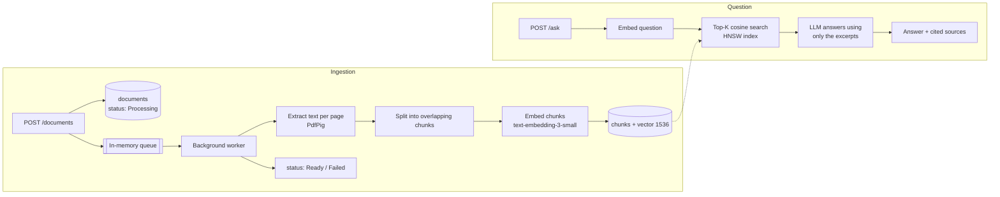

# AskMyDocs

Ask questions about your PDFs and get answers grounded in their content, with citations to the exact file and page.

AskMyDocs is a **RAG (Retrieval-Augmented Generation)** API built with **.NET 10**, **PostgreSQL + pgvector** and **OpenAI**. Upload a PDF; it is split into chunks, embedded, and indexed. When you ask a question, the most relevant chunks are retrieved by vector similarity and the model answers **using only those excerpts**.

## Features

- 📄 PDF upload with background processing (the request returns immediately with `202 Accepted`)
- ✂️ Page-aware chunking with overlap, so context isn't lost at chunk boundaries
- 🔎 Semantic search with pgvector (HNSW index, cosine distance)
- 💬 Grounded answers with `[n]` citations, file name and page number for every source
- 🎯 Optional filter to ask about specific documents only
- 🌎 Answers in the same language as the question
- 🛡️ Resilient ingestion: failures are recorded on the document (`Failed` + reason) instead of taking the API down

## How it works



## Tech stack

| Area | Technology |
| --- | --- |
| API | ASP.NET Core 10 Minimal APIs, OpenAPI |
| Database | PostgreSQL 17 + [pgvector](https://github.com/pgvector/pgvector), EF Core 10, Npgsql |
| AI | [OpenAI .NET SDK](https://github.com/openai/openai-dotnet): `text-embedding-3-small` (embeddings), `gpt-4.1-mini` (answers) |
| PDF | [PdfPig](https://github.com/UglyToad/PdfPig) |
| Background work | `System.Threading.Channels` + `BackgroundService` |
| Tests | xUnit |

## Getting started

### Prerequisites

- [.NET 10 SDK](https://dotnet.microsoft.com/download)
- [Docker](https://www.docker.com/) (for PostgreSQL with pgvector)
- An [OpenAI API key](https://platform.openai.com/api-keys)

### 1. Start the database

```bash
docker compose up -d
```

This starts `pgvector/pgvector:pg17` on **host port 5433** (so it doesn't clash with a locally installed PostgreSQL on 5432). The development connection string in `appsettings.Development.json` already points to it.

### 2. Configure your OpenAI key

```bash
dotnet user-secrets set "OpenAI:ApiKey" "sk-..." --project src/AskMyDocs.Api
```

Alternatively, set the `OPENAI_API_KEY` environment variable.

> **Heads-up:** user secrets override `appsettings.Development.json`. If you have a `ConnectionStrings:Default` secret (for example, pointing to a hosted database), it will be used instead of the Docker database. Check with `dotnet user-secrets list --project src/AskMyDocs.Api`.

### 3. Run the API

```bash
dotnet run --project src/AskMyDocs.Api
```

The API listens on `http://localhost:5261`. In Development, EF Core migrations are applied automatically on startup, and the OpenAPI document is served at `/openapi/v1.json`.

## Usage

### Upload a PDF

```bash
curl -F "file=@./handbook.pdf" http://localhost:5261/documents
```

```json
{
  "id": "72518736-d371-49a9-ae81-54941120b45f",
  "fileName": "handbook.pdf",
  "status": "Processing",
  "errorMessage": null,
  "chunkCount": 0,
  "createdAt": "2026-11-11T17:59:13.39Z"
}
```

### Check its status

```bash
curl http://localhost:5261/documents/72518736-d371-49a9-ae81-54941120b45f
```

Wait until `status` is `Ready`. If it is `Failed`, `errorMessage` explains why (e.g. the PDF is a scanned image with no extractable text).

### Ask a question

```bash
curl -X POST http://localhost:5261/ask \
  -H "Content-Type: application/json" \
  -d '{ "question": "How many vacation days do employees get?" }'
```

```json
{
  "answer": "Employees get 30 vacation days per year [1].",
  "sources": [
    {
      "index": 1,
      "documentId": "72518736-d371-49a9-ae81-54941120b45f",
      "fileName": "handbook.pdf",
      "pageNumber": 1,
      "excerpt": "The vacation policy grants 30 days per year...",
      "similarity": 0.8123
    }
  ]
}
```

Optional fields: `documentIds` (restrict the search to specific documents) and `topK` (number of excerpts, 1–20, default 5).

You can also use [`AskMyDocs.Api.http`](src/AskMyDocs.Api/AskMyDocs.Api.http) from Visual Studio, Rider or VS Code (REST Client).

## API reference

| Method | Route | Description |
| --- | --- | --- |
| `POST` | `/documents` | Upload a PDF (`multipart/form-data`, field `file`, max 20 MB). Returns `202`. |
| `GET` | `/documents` | List documents with status and chunk count. |
| `GET` | `/documents/{id}` | Get a document and its processing status. |
| `DELETE` | `/documents/{id}` | Delete a document and its chunks. |
| `POST` | `/ask` | Ask a question: `{ question, documentIds?, topK? }`. |

Validation errors are returned as `400` [Problem Details](https://www.rfc-editor.org/rfc/rfc9457).

## Configuration

| Key | Default | Description |
| --- | --- | --- |
| `ConnectionStrings:Default` | Docker DB (Development) | PostgreSQL connection string. |
| `OpenAI:ApiKey` | — | OpenAI API key (or `OPENAI_API_KEY`). |
| `OpenAI:ChatModel` | `gpt-4.1-mini` | Model used to write answers. |
| `OpenAI:EmbeddingModel` | `text-embedding-3-small` | Embedding model (vectors have 1536 dimensions). |

## Project structure

```
src/AskMyDocs.Api
├── Domain/                     # Document and Chunk entities
├── Features/
│   ├── Documents/              # Upload, list, get, delete endpoints
│   └── Ask/                    # Retrieval + answer generation endpoint
├── Ingestion/                  # PDF extraction, chunking, queue and worker
└── Infrastructure/
    ├── AI/                     # OpenAI embedding and chat services
    └── Persistence/            # DbContext, EF configurations, migrations
tests/AskMyDocs.Api.Tests       # Unit tests (chunking, PDF extraction)
```

## Running the tests

```bash
dotnet test
```

## Limitations and next steps

- **In-memory queue:** pending uploads are lost if the API restarts. Those documents are marked `Failed` on startup, so you can upload them again. A durable queue (or storing the file) would fix this.
- **No OCR:** scanned PDFs (images only) have no extractable text and end up as `Failed`.
- **No authentication:** every document is visible to every caller.
- **Single-turn questions:** there is no conversation history yet.
- Possible improvements: answer streaming, hybrid search (full-text + vector), reranking, and a simple web UI.
